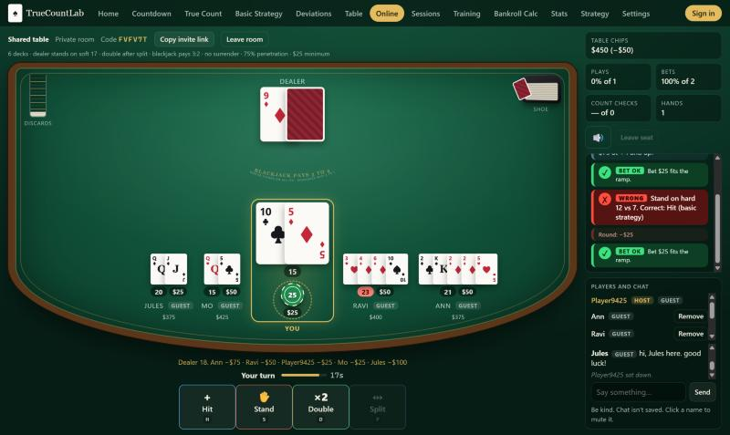
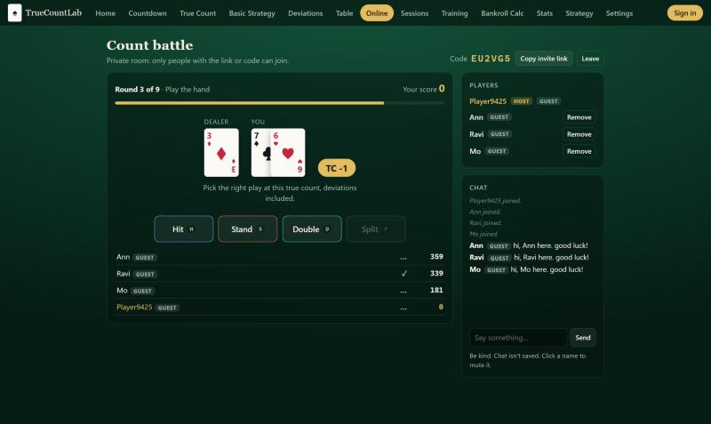
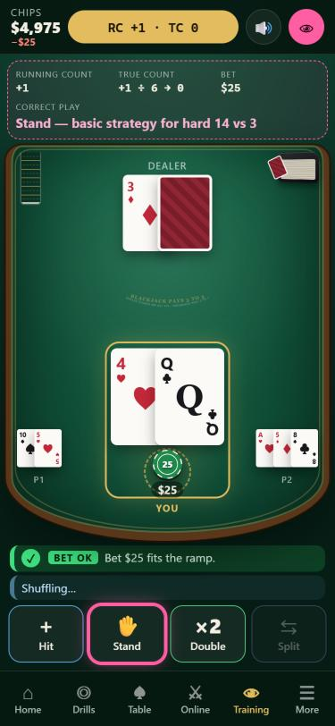
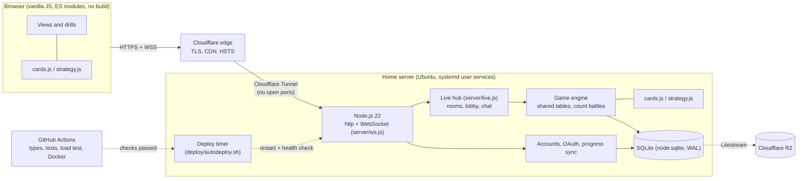

# TrueCountLab

[](https://github.com/adnvanv/truecountlab/actions/workflows/ci.yml)


A blackjack card-counting trainer with real-time multiplayer, live at **[truecountlab.com](https://truecountlab.com)**. Drill Hi-Lo counting, true counts, basic strategy and deviations, play full shoes, or sit at a shared table and race other players in count battles. The server deals every card and grades every play.



| Count battle | On a phone |
|---|---|
|  |  |

## Highlights
- **Real-time multiplayer on a hand-written WebSocket server** (RFC 6455 framing, fragmentation, ping/pong, close codes) on Node's built-in `http`, with no dependencies. Shared tables seat 5 players at one shoe; count battles race up to 8.
- **The server is authoritative.** It deals, keeps the clock, and grades bets, plays, insurance and count checks with the same strategy code the browser uses. No card is sent before it's on screen, and moves are only accepted while the table is waiting for one.
- **Measured capacity:** one Node process on a 4-core home server ran **1,500 concurrent tables (7,500 players) at a p95 move round trip of 63 ms** with zero errors ([load test](#load-test)).
- **Accounts:** email/password (scrypt), Google and Discord OAuth (PKCE, no auto-merge), revisioned progress sync with conflict merging, Elo ratings, leaderboards.
- **Type-checked JavaScript, no build step:** JSDoc types checked by TypeScript 7 (`tsc --checkJs`). The server and the shared game logic pass strict mode.
- **CI/CD:** GitHub Actions runs the type check, 100 tests (42 game-rules tests with stacked shoes and 58 end-to-end tests with scripted players), a load-test smoke run and a Docker build. The server deploys a commit only after all of them pass, and rolls back by itself if the new version fails its health check.
- **Operations:** structured JSON logs, Prometheus metrics, health checks, nightly database snapshots plus continuous Litestream replication, and graceful restarts.

## Architecture

- **One process, in-memory rooms.** A room's state lives with the process that hosts it, and the database only stores accounts, progress, ratings and usage totals. That's why one process is fast, and also where it tops out (see below). Scaling past that means running several processes and routing each room code to one of them.
- **Grading code is shared:** `public/js/cards.js` and `strategy.js` run in the browser for solo drills, and the server imports the same files to grade online play.
- **State updates are coalesced:** many changes in one tick send one update per player, with each player's private view (their grading, their available moves) built on the server.

## Load test
`loadtest/` is a Go program in which each simulated player is a goroutine with its own WebSocket connection. Players sit at real tables (5 a table) and play hands: they bet, hit or stand, decline insurance and answer count checks. It times every action from send to the server's next state update, raises the table count in stages, and reads the server's CPU, memory and event-loop delay from `/metrics`.

Results on the production machine (Intel 4-core, 16 GB, Node 22, server and load generator on the same box), from [`docs/loadtest-results.json`](docs/loadtest-results.json):

| Tables | Players | Move p50 | Move p95 | Move p99 | Actions/s | Server CPU (1 core) | Memory | Errors |
|---:|---:|---:|---:|---:|---:|---:|---:|---:|
| 100 | 500 | 2 ms | 9 ms | 18 ms | 85 | 26% | 124 MB | 0 |
| 250 | 1,250 | 3 ms | 11 ms | 20 ms | 224 | 54% | 179 MB | 0 |
| 500 | 2,500 | 3 ms | 26 ms | 41 ms | 446 | 73% | 214 MB | 0 |
| 1,000 | 5,000 | 9 ms | 51 ms | 104 ms | 906 | 88% | 227 MB | 0 |
| **1,500** | **7,500** | **14 ms** | **63 ms** | **139 ms** | **1,347** | **100%** | **262 MB** | **0** |
| 2,000 | 10,000 | 362 ms | 501 ms | 523 ms | 1,472 | saturated | 494 MB | 0 |

At 1,500 tables the single JavaScript thread is fully used. Past that, moves queue (500 ms at 2,000 tables), but nothing errors or drops. CI runs a 25 and 100 table smoke test on every push.

```
cd loadtest && go run . -url http://127.0.0.1:3099 -steps 100,500,1000 -duration 45s
```
Run it against a test server started with raised limits (`LIVE_MAX_PER_IP`, `LIVE_MAX_ROOMS`, `LIVE_ROOMS_PER_MIN`), never against the live site; the tool refuses `truecountlab.com`.

## The game
- **Rules:** 6 decks, S17, DAS, 3:2, no surrender, 75% penetration, $25 minimum.
- **Count:** Hi-Lo. True count = running count ÷ decks remaining (estimated to the nearest half deck), rounded down.
- **Deviations:**
  - Core: insurance +3, 16v10 stand 0, 15v10 stand +4, 12v3 stand +2, 12v2 stand +3, 10v10 double +4, 10vA double +4, 9v2 double +1.
  - Low-count hits: 12v4 below 0, 12v5 below −2, 12v6 below −1, 13v2 at −1 or lower, 13v3 at −2 or lower.
  - Extras: 11vA double +1, 9v7 double +3, 8v6 double +2, 8v5 double +4, 16v9 stand +5.
  - Optional surrender (off by default): 15v10 0, 14v10 +3, 15v9 +2, 15vA +1.
- **Bet ramp:** $25 at TC ≤ +1, $50 at +2/+3, $75 at +4 and up. **Bankroll:** $3,000, $500 session buy-in and stop-loss.

**Solo modes**
- **Countdown:** flash cards from a fresh deck, then enter the running count. The goal is deck pace (≤ 0.58 s a card).
- **True Count:** a running count and a discard tray. Mistakes are classified (rounding, decks played instead of remaining, a bad deck estimate).
- **Basic Strategy:** random hands with instant feedback and a mistake heatmap.
- **Deviations:** hands at a given true count, weighted toward the deviations you miss, plus a threshold drill.
- **Table:** full shoes with simulated players. Your play, deviations and bets are graded, with random count checks. **Training** is the same table with a cheat panel.
- **Sessions, Stats, Bankroll Calc:** logged results, accuracy over time, and EV / SD / risk of ruin from a simulated true-count distribution.
- **Home:** a ready-to-play checklist that unlocks when all four gates hold at once: deck-pace countdowns, 98% basic strategy, 95% true count and 95% deviations.

**Online** (`#play`)
- **Count battles:** running-count, true-count and play-the-hand rounds. Everyone gets the same question at the same moment, and a right answer scores 100 plus up to 100 for speed.
- **Shared tables:** 5 seats, $500 in table chips, private grading. Letting a timer run out is graded as what happens (stand, no insurance, a missed check), and missing the bet timer gives up your seat.
- **Rooms:** quick play, private rooms by code or invite link, host controls, and room chat (masked, rate-limited, never saved).
- **Leaderboards** for signed-in players: battle Elo, wins (outright first only), battle accuracy, and table play and count-check accuracy.

## Learn guides
Static, crawlable pages at [`/learn`](https://truecountlab.com/learn): how to count cards (Hi-Lo), the true count, a basic strategy chart and index plays. Each one links into the drill for that skill.
- The trainer itself lives behind `#` routes, which search engines don't index, so these pages carry the site's searchable content. Each has its own title, description, canonical URL, Open Graph tags and schema.org data (Article, BreadcrumbList, Course, FAQPage). `robots.txt` and `sitemap.xml` are in `public/`.
- The strategy and index tables are generated from `public/js/strategy.js` by `node scripts/learn-tables.mjs`, and CI runs it with `--check`, so the guides can't disagree with what the drills grade.

## Accounts and privacy
- **Sign-in:** email + password (scrypt), or Google / Discord. A provider login is never auto-merged into a password account with the same email; you connect it from the Account page.
- **Sessions:** random tokens in `HttpOnly`, `SameSite=Lax` cookies (`Secure` on https). Only their SHA-256 is stored.
- **Sync:** one JSON document per account with a revision number. A stale save gets `409` plus the newer copy, and the client merges and retries.
- **Protection:** rate limits per IP and per account, origin checks on every write and every WebSocket, a Content-Security-Policy, and HSTS.
- **Your data:** export or delete your account from the Account page. Usage totals are anonymous counts only. See [`/privacy`](https://truecountlab.com/privacy).

## Operations
- **Health:** `GET /healthz` returns `{"status":"ok","db":"ok","build":…,"commit":…,"backups":{…}}` (503 if the database doesn't answer).
- **Alerts:** the [Uptime workflow](.github/workflows/uptime.yml) checks `/healthz` from outside every 15 minutes. If the site is down or a backup is stale, the run fails and GitHub emails the repository owner.
- **Metrics:** `GET /metrics` serves Prometheus text: HTTP rate and latency by route, WebSocket messages and handling time by move type, event-loop delay, memory, CPU, connections, rooms and usage totals. It's only served to the server itself and the private network, never through Cloudflare.
- **Logs:** one JSON object per line (`server/log.js`), filterable with `journalctl --user -u count-trainer -o cat | jq 'select(.level=="error")'`.
- **Usage:** `GET /api/stats` (accounts, hands, plays graded, battles), with shields.io badge endpoints at `/api/badge/hands|graded|battles|accounts`.
- **Backups:** two layers, one local and one off-site. See [Backups](#backups).
- **Shutdown:** on SIGTERM, live players are told the site is updating, connections close with code 1012 (browsers reconnect by themselves), and usage counters are flushed.

## Backups
The whole site's state is one SQLite file, `data/truecountlab.db`, so it's backed up two ways:

| | Local snapshots | Off-site replica |
|---|---|---|
| Tool | `deploy/backup.sh` | [Litestream](https://litestream.io) 0.5 (`deploy/litestream.yml`) |
| Where | `~/backups/truecountlab` on the server | Cloudflare R2 bucket `truecountlab-backups` |
| When | Nightly at 04:30 and before every deploy | Every change, uploaded within 1 minute |
| Kept | 14 nightly and 10 pre-deploy copies | 3 days of snapshots and changes |
| Protects against | A bad deploy or migration, an accidental delete | Losing the machine or its disk |

- **Local snapshots** use `VACUUM INTO`, so the copy is consistent while the app keeps writing. Each copy passes `PRAGMA integrity_check` before it's gzipped and kept.
- **The R2 replica** follows SQLite's write-ahead log: a full snapshot once a day, plus small change files merged every 10 minutes and every hour. The R2 token can only read and write that one bucket.
- **Cost:** it stays inside R2's free tier. That's a few MB stored against 10 GB free, and at most about 48,000 uploads a month against 1,000,000 free (which is why the sync interval is 1 minute). Downloads are free, and a $1 budget alert on the account catches anything unexpected.

**Restore** (stop the app first, so nothing writes to the database while it's replaced):
```
systemctl --user stop count-trainer
# From R2: the latest state, to within about a minute
set -a; . ~/blackjack/.env; set +a
litestream restore -config ~/blackjack/deploy/litestream.yml -o /tmp/restored.db ~/blackjack/data/truecountlab.db
# Or from a local snapshot
gunzip -c ~/backups/truecountlab/<file>.db.gz > /tmp/restored.db
# Then swap it in
mv ~/blackjack/data/truecountlab.db{,.broken}; rm -f ~/blackjack/data/truecountlab.db-{wal,shm}
mv /tmp/restored.db ~/blackjack/data/truecountlab.db
systemctl --user start count-trainer && systemctl --user restart litestream
```
The R2 restore was tested on 2026-11-27: it came back with an `ok` integrity check and every table.

**Monitoring:** every hour, `deploy/backup-status.sh` (run by `truecountlab-backup-status.timer`) checks both layers and writes `data/backup-status.json`, which `/healthz` reports as `backups`. The Uptime workflow fails, and GitHub emails you, if:
- the newest local snapshot is over 27 hours old,
- R2 is missing a change made more than 2 minutes before the check (it compares transaction ids, so a quiet day with no writes isn't an alarm), or
- the hourly check itself stops running.

**Check on it:**
- `curl -s https://truecountlab.com/healthz | jq .backups`
- `systemctl --user status litestream`
- `journalctl --user -u litestream -o cat`
- `litestream ltx -config ~/blackjack/deploy/litestream.yml ~/blackjack/data/truecountlab.db` lists what's in R2. It needs `.env` loaded, as in the restore steps.
- `ls -lh ~/backups/truecountlab`

## Develop
```
node --disable-warning=ExperimentalWarning server.js   # http://127.0.0.1:3040
```
Vanilla JS with ES modules: no build step, and no runtime dependencies. `HOST` and `PORT` choose where it listens.

```
npm ci --prefix tools && npm run typecheck --prefix tools      # tsc --checkJs (dev-only tooling)
node --disable-warning=ExperimentalWarning scripts/test-games.mjs   # 49 game-rules tests, stacked shoes
node scripts/test-live.mjs                                     # 58 end-to-end tests against a throwaway server
node scripts/check-null-text.js                                # no "null" printed as page text
node scripts/learn-tables.mjs --check                          # guide tables match strategy.js
```
- **Type checks:** four projects. `tsconfig.server.json` and `tsconfig.core.json` (the server and `cards.js` / `strategy.js`) are strict. `tsconfig.web.json` and `tsconfig.scripts.json` check the views and test scripts without strict mode. Shared server types live in `server/types.d.ts`.
- **Assets:** scripts and stylesheets are served from `/v/<build>/…`, where the build id is a hash of `public/`. Every deploy changes every asset URL, so no browser or CDN keeps old code.
- **Docker:**
  ```
  docker build -t truecountlab . && docker run -p 3040:3040 -v tcl-data:/data truecountlab
  ```

## Deploy
```
git push
```
`git push` sends `main` to GitHub, where CI runs. On the server, `truecountlab-deploy.timer` runs `deploy/autodeploy.sh` every minute:
1. Fetch `main` from GitHub.
2. Wait until every CI check on the new commit has passed (read from the public GitHub API, so no token is needed).
3. Snapshot the database.
4. Check out the commit, install its systemd units, and restart the app.
5. Wait for `/healthz` to report the new commit. If it doesn't within 30 s, roll back and skip that commit.

Nothing on the server is reachable from the internet except through the Cloudflare Tunnel (`deploy/cloudflared.service` forwards `truecountlab.com` to `127.0.0.1:3040`), and GitHub holds no secrets. Database migrations only add tables or columns, so a rollback never needs to undo one. In an emergency, `FORCE=1 bash ~/blackjack/deploy/autodeploy.sh` deploys without waiting for CI.

**Server-only files** (never in git, kept across deploys):
- `.env`: `HOST`, `PORT`, and the OAuth, email and R2 keys, saved with `scripts/set-keys.sh google|discord|email|r2`. Secrets are typed hidden.
- `data/`: the database.

OAuth redirect URIs are `https://truecountlab.com/auth/{google,discord}/callback`; provider sign-in is offered only on the public address.

**Useful commands:**
- `systemctl --user status count-trainer truecountlab-deploy.timer litestream`
- `journalctl --user -u truecountlab-deploy -o cat`

## Credits
Card and chip sounds: [Casino Audio](https://kenney.nl/assets/casino-audio) by Kenney (CC0).
